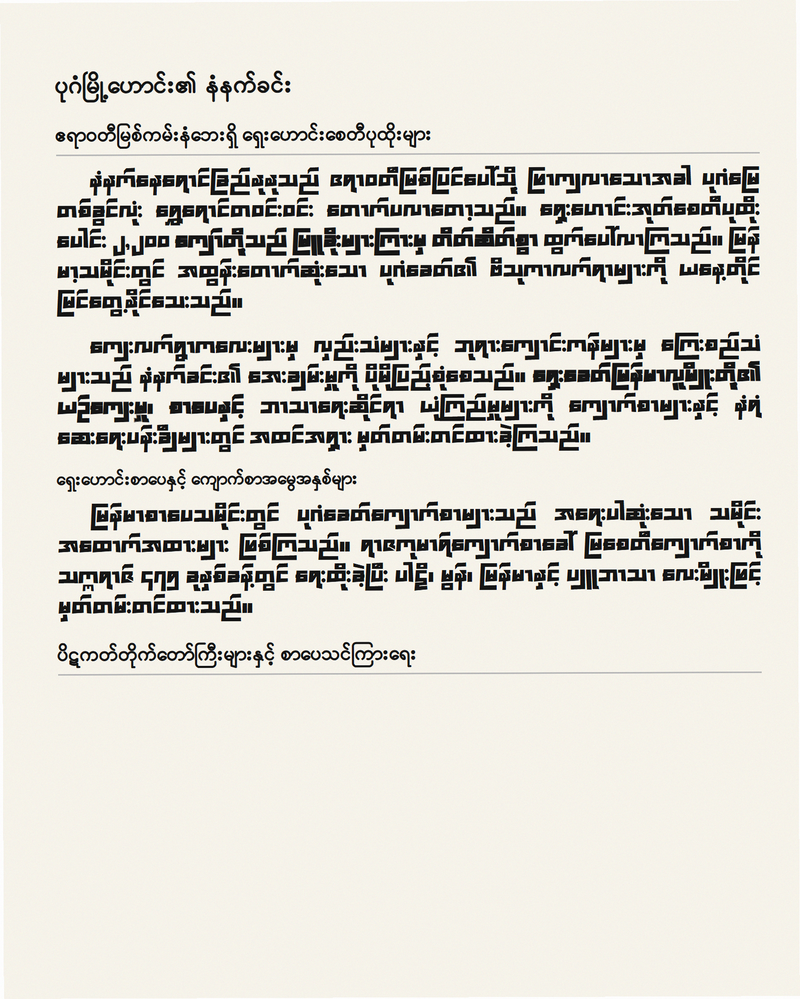
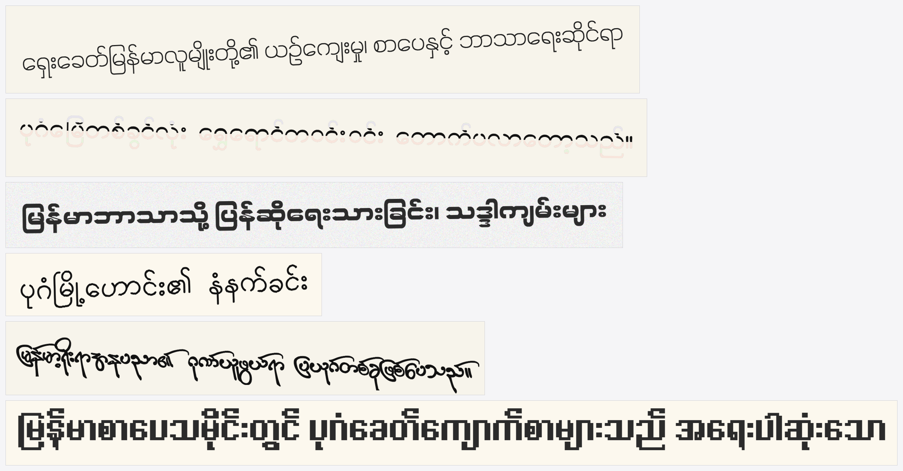

# BurVision Dataset Builder

An open-source synthetic data generation and document rendering pipeline for building high-resolution, layout-aware Burmese (Myanmar) OCR datasets with image and text annotations.

**BurVision** automatically harvests **200+ free & open Myanmar Unicode fonts** across 4 major open-source font repositories ([AungMyoKyaw/Myanmar-Unicode-Fonts](https://github.com/AungMyoKyaw/Myanmar-Unicode-Fonts), [Google Fonts](https://github.com/google/fonts), [lecramyajiv/fonts-myanmar-extra](https://github.com/lecramyajiv/fonts-myanmar-extra), and [saturngod/myanmar-unicode-fonts](https://github.com/saturngod/myanmar-unicode-fonts)), and supports **dual-mode dataset generation** via **Headless Chromium/Edge (`mym2` HarfBuzz + DirectWrite)** for 100% authentic Burmese glyph shaping:

1. **Page Mode (`"page"`):** Formats long Burmese stories into structured A4 book pages with `#H1`, `#H2`, `#H3` hierarchy, intra-page header + body font pairings, and realistic scan augmentations for Vision-Language Models (VLMs).
2. **Line Mode (`"line"`):** Uses BurVision's `mym2` HarfBuzz renderer with an integrated augmentation pipeline (skew, wave distortion, blur, and multi-background synthesis) to produce single-line OCR crops and export directly to **PaddleOCR** and **Hugging Face `imagefolder`** formats.

---

## Sample Outputs

### Full-Page Document Rendering (`page` mode)


### TRDG-Style Line Crops (`line` mode with `mym2` HarfBuzz shaping)


---

## 1. Key Architecture & Dataset Specifications

| Feature | Specification |
| :--- | :--- |
| **Pipeline Modes (`PIPELINE_MODE`)** | `"page"` (full A4 documents), `"line"` (TRDG-style line crops), or `"both"` |
| **Total Myanmar Unicode Fonts** | **200+ fonts** harvested across 4 repositories (`AungMyoKyaw/Myanmar-Unicode-Fonts`, `Google Fonts` weights 100–900, `lecramyajiv/fonts-myanmar-extra`, `saturngod/myanmar-unicode-fonts`) |
| **Intra-Page Font Pairing** | **Dual-Font Book Typography** (pages pair a dedicated display/bold Header Font for `#H1`/`#H2`/`#H3` with a distinct Body Font) |
| **Ground Truth & Exports** | **VLM JSONL** (`train.jsonl`, `val.jsonl`), **PaddleOCR** (`train.txt`, `val.txt`, `myanmar_dict.txt`), and **Hugging Face** (`metadata.csv`) |
| **Source Corpus** | Local UTF-8 `.txt` files (`raw_texts/`), optional **Hugging Face Corpus Harvester** (`ENABLE_HF_CORPUS = True`), or synthetic literary stories |
| **Shaping & Encoding Purity** | **100% Verified Pure Unicode 5.1+ (`NFC`)** (`paraencoder` auto-conversion + strict exclusion of non-Unicode Zawgyi/Win fonts + Browser `mym2` HarfBuzz shaping) |
| **Augmentations** | **Page:** Warm paper, spine shadow, micro-rotation (`±0.5°`), sensor grain • **Line:** TRDG-style skew, sine/cosine wave distortion, blur, Gaussian noise, gradient texture, and custom backgrounds |

## 2. Corpus Options (Local `.txt` or Hugging Face Harvester)

This repository shares the dataset-generation workflow and sample previews, not a bundled text corpus or generated dataset. The working folder `burmese_ocr_project/` is excluded from Git. You can supply text in two ways:

1. **Local `.txt` files:** Place UTF-8 `.txt` files in `burmese_ocr_project/raw_texts/`.
2. **Hugging Face Corpus Harvester:** Set `ENABLE_HF_CORPUS = True` in Cell 4 to automatically download, normalize (`NFC`), and clean Burmese text from Hugging Face datasets (e.g., `chuuhtetnaing/wikipedia`).

### Optional Synthetic Literary Prompt (Gemini)

```text
System / Master Instruction:
You are a master native Burmese literary writer. Output ONLY raw Burmese text in standard Unicode (NFC). Do not include any English intros, conversational text, or markdown symbols at the start of lines.
Write an ultra-long, deeply detailed Burmese story (1,200 to 2,000+ words—make it as long as possible). Rotate through or combine these themes:
၁။ မြန်မာ့သမိုင်းနောက်ခံ ပုဂံခေတ် အဖြစ်အပျက်တစ်ခုအကြောင်း ဝတ္ထုတို
၂။ ကျေးလက်ရွာကလေးတစ်ရွာ၏ ရိုးရာဓလေ့နှင့် သဘာဝပတ်ဝန်းကျင်အကြောင်း
၃။ မြန်မာရိုးရာ ဒဏ္ဍာရီ ပုံပြင်ဆန်ဆန် ဇာတ်လမ်းတစ်ပုဒ်
၄။ မြို့ပြလူနေမှုဘဝ၊ မိသားစုမေတ္တာနှင့် ကြိုးစားအားထုတ်မှုအကြောင်း ဝတ္ထုတို
၅။ ဆန်းကြယ်သော တောတွင်းခရီးသွား စွန့်စားခန်းပုံပြင်
၆။ ပညာရေး၊ စာပေလေ့လာလိုက်စားမှုနှင့် ဆရာတပည့် သံယောဇဉ်အကြောင်း
၇။ ကုန်သည်ကြီးများ၏ ရောင်းဝယ်ဖောက်ကားမှုနှင့် စီးပွားရေးအခြေအနေအကြောင်း
၈။ ဗုဒ္ဓဝင် သို့မဟုတ် ငါးရာ့ငါးဆယ် ဇာတ်နိပါတ်တော် လာ အကြောင်းအရာတစ်ခု
Strict Formatting & Style Rules:
- Trailing Heading Tags Only: Put #H1, #H2, and #H3 at the very end of the heading lines:ခေါင်းစဉ် - [Title] #H1[Major Section Title] #H2[Sub-section Scene Title] #H3
- Structure: Include 1 #H1 title, at least 3 #H2 major sections, and at least 2 #H3 sub-sections under each #H2 section. Write 2 to 4 long, rich paragraphs under every single heading.
- Language: Use rich Burmese vocabulary, stacked consonants (ပါဠိဆင့်), Burmese numbers (၀-၉), vivid atmospheric descriptions, and natural dialogue with 100% correct spelling (စာလုံးပေါင်းသတ်ပုံ အမှန်).
```

## 3. Why Native Browser HarfBuzz (`mym2`) Shaping Matters

In standard Myanmar Unicode (`NFC`), characters are stored in **logical phonetic order**:

* The word `တောင်` is stored in memory as `တ` + `ေ` (`U+1031`) + `ာ` + `င` + `်`.
* The word `ပြည်` is stored in memory as `ပ` + `ြ` (`U+103C`) + `ည` + `်`.

Lightweight PDF/image libraries (such as PyMuPDF's `insert_htmlbox` or Pillow without `libraqm`/`fribidi.dll`) draw glyphs in raw memory order without running the OpenType **`mym2` (Myanmar v2)** shaping state machine—resulting in unshaped text where `ေ` and `ြ` appear on the wrong side of the consonant (`တေောင်`, `ပည်`).

**BurVision solves this permanently** by serving all 200+ Unicode fonts over a local background HTTP thread to a single persistent **Headless Chrome / Microsoft Edge** instance via Selenium. The browser's native **HarfBuzz + DirectWrite** engine executes full OpenType `GSUB`/`GPOS` shaping for both full pages and TRDG-style line crops with zero external C/GTK installation steps on Windows, macOS, or Linux.

## 4. Harvested Myanmar Unicode Fonts (4 Repositories)

The dataset builder automatically downloads, deduplicates, and verifies 200+ distinct Myanmar Unicode `.ttf`/`.otf` font files across four open-source collections while strictly blocking legacy non-Unicode encodings (`Zawgyi-One`, `WININNWA`, `Padauk-Zawgyi`):

1. **[AungMyoKyaw/Myanmar-Unicode-Fonts](https://github.com/AungMyoKyaw/Myanmar-Unicode-Fonts) (78 Pure Unicode Fonts)**
2. **[Google Fonts (`google/fonts`)](https://github.com/google/fonts) (16 Full-Spectrum Weight Fonts — `NotoSansMyanmar` & `NotoSerifMyanmar` 100–900)**
3. **[lecramyajiv/fonts-myanmar-extra](https://github.com/lecramyajiv/fonts-myanmar-extra) (20+ Masterpiece & Debian/Slackware Extra Myanmar Fonts)**
4. **[saturngod/myanmar-unicode-fonts](https://github.com/saturngod/myanmar-unicode-fonts) (Community Designer Burmese Unicode Fonts)**

## 5. Repository Structure

```text
BurVision-Dataset-Builder/
├── readme.md                              # Workflow documentation & sample previews
├── burmese_ocr_dataset_builder.ipynb      # Dual-mode dataset generator (Page + Line/TRDG)
├── samples/                               # Sample rendered outputs for preview
│   ├── sample_page.png
│   └── sample_lines_grid.png
└── burmese_ocr_project/                   # Created locally; excluded from Git
    ├── raw_texts/                         # Place UTF-8 .txt files here (or enable HF corpus)
    ├── fonts/                             # Downloaded Myanmar Unicode fonts
    ├── backgrounds/                       # Optional real images for TRDG background_type=3
    └── dataset_output/
        ├── images/                        # Rendered A4 page PNGs
        ├── line_images/                   # Rendered TRDG-style line crop PNGs
        ├── train.jsonl & val.jsonl        # VLM chat-format annotations
        ├── paddleocr/                     # train.txt, val.txt, and myanmar_dict.txt
        └── hf_dataset/                    # train/ & val/ folders with metadata.csv
```

## 6. Build a Dataset from Your Own Text

1. Clone or download this repository, then run the notebook's setup cells (`burmese_ocr_dataset_builder.ipynb`).
2. Configure `PIPELINE_MODE` (`"page"`, `"line"`, or `"both"`) and optionally `ENABLE_HF_CORPUS` in Cell 4, or place UTF-8 `.txt` files in `burmese_ocr_project/raw_texts/`.
3. Run the cells from top to bottom (requires internet for font harvesting and Chrome or Microsoft Edge for rendering).
4. Find your exported datasets in `burmese_ocr_project/dataset_output/` (`train.jsonl`/`val.jsonl`, `paddleocr/`, and `hf_dataset/`).

## 7. Exporting & Publishing the Dataset

Run **Block 8** to create `burmese_ocr_poc.zip` locally from the generated dataset. The notebook does not require credentials or upload data to GitHub, Hugging Face, or Kaggle; publish the generated files or archive manually to the platform you choose.

## 8. References & Acknowledgments

* **Font Collections:** [AungMyoKyaw/Myanmar-Unicode-Fonts](https://github.com/AungMyoKyaw/Myanmar-Unicode-Fonts), [Google Fonts](https://github.com/google/fonts), [lecramyajiv/fonts-myanmar-extra](https://github.com/lecramyajiv/fonts-myanmar-extra), and [saturngod/myanmar-unicode-fonts](https://github.com/saturngod/myanmar-unicode-fonts).
